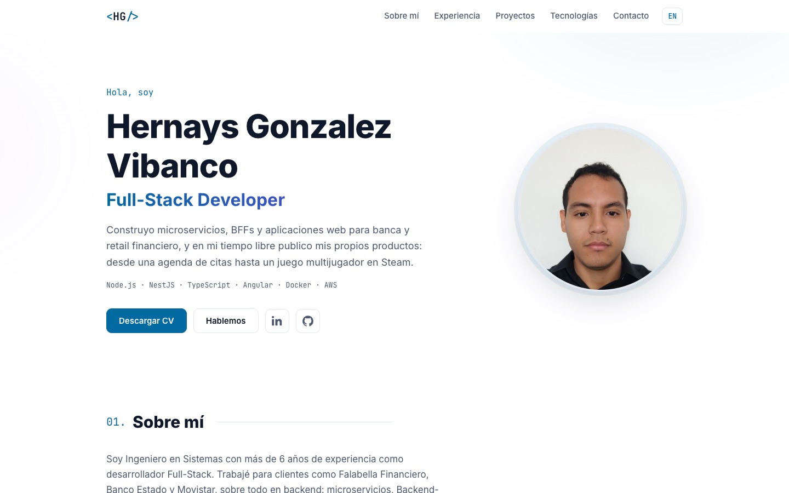

# Portafolio · Hernays Gonzalez

**🌐 [hernays.dubenails.com](https://hernays.dubenails.com)**



Mi portafolio personal: experiencia, proyectos propios, tecnologías, CV descargable y formulario de contacto.

## Qué tiene

- Una sola página, responsiva y en **español e inglés** (recuerda el idioma elegido).
- Experiencia en línea de tiempo y tarjetas de proyectos con enlaces en vivo.
- **Formulario de contacto** que envía el mensaje por correo, con validación del lado del servidor, HTML escapado, campo trampa contra bots y límite de envíos por IP.
- Sin frameworks en el frontend: HTML, CSS y JavaScript puros, cero dependencias en el navegador.

## Stack


## Correr en local

```bash
npm install
cp .env.example .env   # completar las variables
node src/app.js        # http://localhost:1020 (o el PORT del .env)
```

| Variable | Para qué |
|---|---|
| `PORT` | Puerto del servidor |
| `correo` | Cuenta de Gmail que envía |
| `CLAVEEMAIL` | Contraseña de aplicación de Gmail |

## Despliegue

Node + pm2 en un VPS Linux, publicado detrás de un túnel de Cloudflare.
